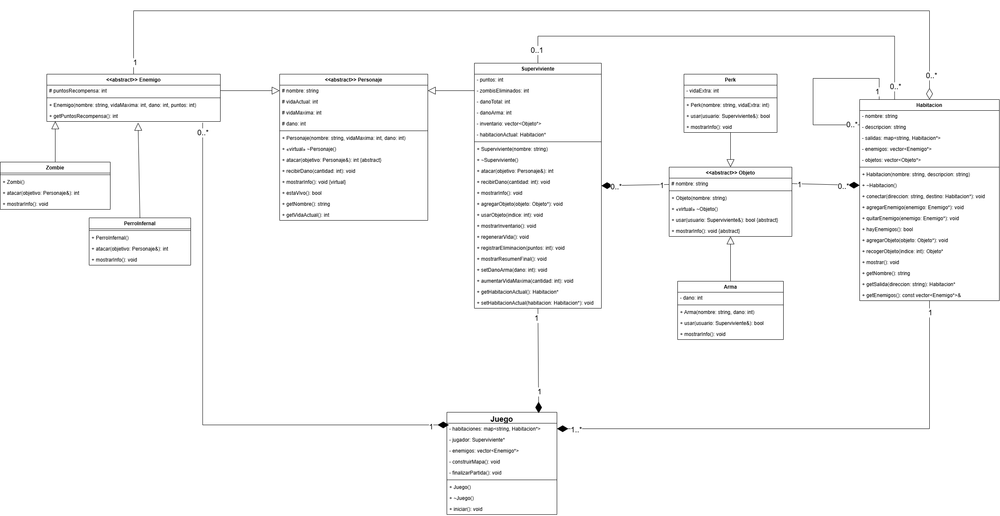
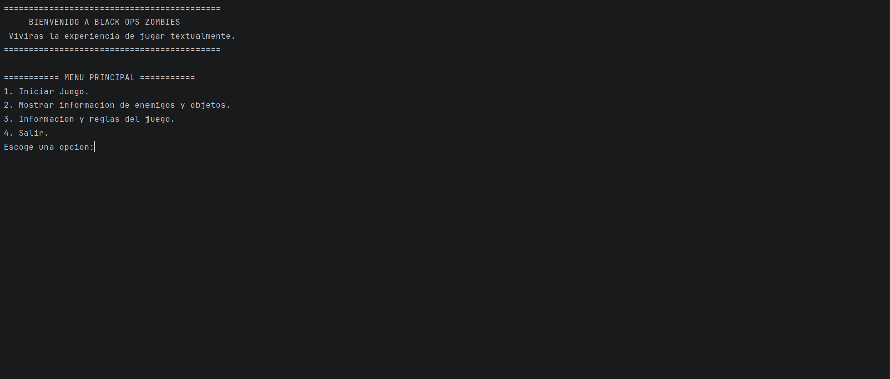
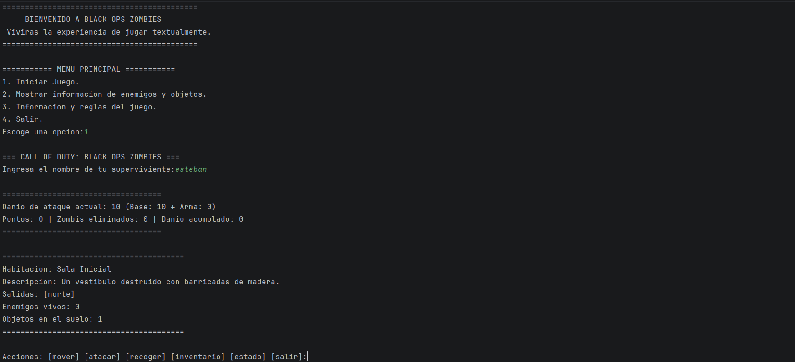

# 🎭 Sistema de Supervivencia: "Teatro de los Muertos"
### 🚀 Proyecto Final - Programación Orientada a Objetos (POO 2026-2)

**"Teatro de los Muertos"** es una aventura textual de rol (RPG) y supervivencia programada completamente en **C++**. La simulación ubica a un sobreviviente dentro de un teatro abandonado con 4 habitaciones iniciales (Vestíbulo, Sala del teatro, Escenario y Sótano), donde deberá combatir por turnos contra letales Zombis y Perros Infernales utilizando armas y perks estratégicos.

El objetivo principal de este desarrollo es modelar y cumplir estrictamente con las reglas de negocio de la rúbrica y aplicar rigurosamente las relaciones de diseño de software y los cuatro pilares de la POO.

---

## 🏛️ Aplicación de los 4 Pilares de la POO

### 1. Abstracción
Se estructuraron clases abstractas que definen interfaces puras sin permitir la instanciación de "entidades genéricas", abstrayendo únicamente los atributos esenciales:
*   `Personaje`: Clase base abstracta (`{abstract}`) que encapsula las propiedades de cualquier entidad viva (`nombre`, `vida`, `vidaMaxima`, `dano`).
*   `Objeto`: Clase base abstracta (`{abstract}`) que rige el comportamiento de todos los ítems del inventario a través de una interfaz de uso general.

### 2. Encapsulamiento
Se protegen los datos del estado interno utilizando niveles de acceso estrictos:
*   Atributos protegidos (`# protected`) en clases base para permitir su acceso a las clases derivadas (`nombre`, `vida`, `vidaMaxima`, `dano` en `Personaje`).
*   Atributos estrictamente privados (`- private`) en `Superviviente` para métricas controladas (`puntos`, `zombisEliminados`, `danoTotal`, `danoArma`).
*   Comunicación externa segura controlada por medio de *Getters* y *Setters* específicos.

### 3. Herencia
Jerarquías de código limpias que extienden el comportamiento base:
*   `Superviviente` y `Enemigo` heredan directamente de `Personaje`.
*   `Zombi` y `PerroInfernal` heredan directamente de `Enemigo`.
*   `Arma` y `Perk` heredan de la clase abstracta `Objeto`.

### 4. Polimorfismo
Implementación de **polimorfismo dinámico** mediante el uso de funciones virtuales puras (`virtual ... = 0`) y enlaces en tiempo de ejecución:
*   `atacar(Personaje& objetivo)`: Se comporta de forma única según la subclase. `Superviviente` suma el `danoArma` y registra estadísticas; `Zombi` ejecuta un golpe simple; `PerroInfernal` ejecuta dos mordidas por turno.
*   `usar()`: Ejecuta una acción destructiva/modificadora diferente si el objeto en el inventario es un `Arma` (asigna daño permanente) o un `Perk` (se consume y altera la vida máxima).
*   `mostrarInfo()`: Sobrescribe la salida en consola para formatear los datos específicos de cada tipo de entidad de manera personalizada.

---

## 🗺️ Diseño de Arquitectura y Relaciones de Memoria

El ciclo de vida del software sigue estrictamente las directrices de acoplamiento descritas en el diseño UML:

*   **Composición Estricta:** El objeto principal `Juego` es el dueño absoluto de las estancias. Las instancias de `Habitacion` no existen fuera del juego; `Juego` las crea y destruye en su ciclo de ejecución. 
*   **Agregación Inversa:** Las habitaciones registran y contienen listas de enemigos (`vector<Enemigo*>`), pero **no les pertenecen**. El ciclo de vida de los enemigos es gestionado por `Juego`, cumpliendo con la regla de que la habitación no los destruye al limpiarse.
*   **Asociación:** El `Superviviente` mantiene un puntero dinámico hacia su `habitacionActual` para gestionar el movimiento e interactuar con el entorno.
*   **Gestión de Memoria Dinámica (RAII):** Para evitar fugas de memoria (*memory leaks*), las clases dueñas de colecciones polimórficas implementan destructores explícitos que liberan la memoria mediante `delete`:
    *   `~Superviviente()`: Destruye los ítems dentro de su `inventario`.
    *   `~Habitacion()`: Destruye los objetos que quedan tirados en el suelo.
    *   `~Juego()`: Libera las habitaciones, los enemigos y al sobreviviente.
    *   `~Personaje()` y `~Objeto()` implementan destructores virtuales (`virtual ~Clase() = default;`) para garantizar que la destrucción de un puntero base ejecute la limpieza del objeto hijo completo.

---

## 🗂️ Estructura del Sistema (10 Clases Principales)

El proyecto cuenta exactamente con las 10 clases especificadas en el alcance base:
1.  `Personaje` (Abstracta base)
2.  `Superviviente` (Hereda de Personaje - Equivale a Jugador)
3.  `Enemigo` (Abstracta, hereda de Personaje)
4.  `Zombi` (Hereda de Enemigo)
5.  `PerroInfernal` (Hereda de Enemigo)
6.  `Objeto` (Abstracta base)
7.  `Arma` (Hereda de Objeto)
8.  `Perk` (Hereda de Objeto)
9.  `Habitacion` (Contenedor de estado local)
10. `Juego` (Controlador principal de turnos, mapa y flujo)

---
## 📐 Diagrama de Clases UML

A continuación se detalla el diseño de clases, herencias y relaciones (composición, agregación y asociación) que estructuran el sistema:



---

## 🎮 Flujo del Juego y Mecánicas

1.  **Inicio:** El jugador arranca con estadísticas limpias en el **Vestíbulo** (Habitación inicial).
2.  **Exploración:** El usuario puede listar las salidas, moverse a nuevas habitaciones (`Sala del Teatro`, `Escenario`, `Sótano`) o recoger objetos del suelo.
3.  **Combate por Turnos:** Al ingresar a un sector hostil, se activa la rutina iterativa:
    *   **Turno Jugador:** Elegir `Atacar` o `Usar Objeto` de su inventario.
    *   **Turno Enemigo:** Los enemigos vivos de la habitación contraatacan según su propio algoritmo de daño.
4.  **Post-Combate:** Al limpiar la sala, el sobreviviente activa `regenerarVida()` recuperando un porcentaje de salud.
5.  **Fin de la Partida:** Ocurre cuando la vida llega a 0 o se derrotan a todos los monstruos del mapa. Se invoca automáticamente `mostrarResumenFinal()` exponiendo: **puntos totales, zombis eliminados y daño total infligido**.

---

## 🛠️ Compilación y Ejecución

Compila el proyecto utilizando cualquier compilador estándar de C++ (mínimo C++11):

```bash
# Compilar todas las clases del proyecto
g++ -std=c++11 main.cpp Juego.cpp Habitacion.cpp Personaje.cpp Superviviente.cpp Enemigo.cpp Zombi.cpp PerroInfernal.cpp Objeto.cpp Arma.cpp Perk.cpp -o teatro_muertos

# Ejecutar el simulador RPG
./teatro_muertos
```

---

## 🖼️ Interfaz de Consola (Gameplay)

Aquí puedes ver una captura de pantalla de la simulación del combate y el menú del inventario:



